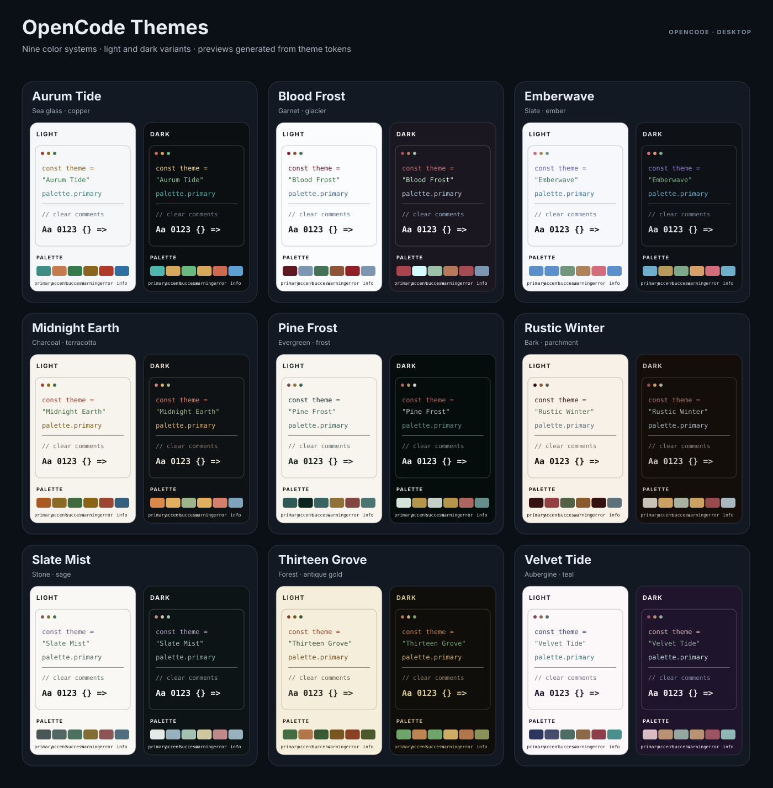

# opencode-themes

`opencode-themes` adds nine color themes to OpenCode Desktop. Every theme includes light and dark variants.

## Included themes

- Aurum Tide
- Blood Frost
- Emberwave
- Midnight Earth
- Pine Frost
- Rustic Winter
- Slate Mist
- Thirteen Grove
- Velvet Tide

## Preview



*These palette-driven previews are generated from the theme files; they are not screenshots of the OpenCode interface.*

## Requirements

- OpenCode Desktop 2.2.6 or later
- An OpenCode version that supports GUI plugins

This is a GUI-only plugin. It does not add commands or features to OpenCode's terminal interface. OpenCode's GUI plugin API is experimental and may change between releases.

## Install

After `opencode-themes` is published to npm, install it with:

```sh
opencode plugin add opencode-themes
```

You can also add the package to your OpenCode configuration file (`opencode.json` or `opencode.jsonc`):

```jsonc
{
  "plugins": ["opencode-themes"]
}
```

To use a local checkout before or instead of an npm release, build it and add its absolute path to the same `plugins` array:

```sh
npm install
npm run validate:themes
npm run generate:gallery
npm run build
```

```jsonc
{
  "plugins": ["/absolute/path/to/opencode-themes"]
}
```

On Windows, use the absolute path to the folder, for example `C:/Users/you/src/opencode-themes`.

## Choose a theme

In OpenCode Desktop, open **Settings > Appearance > Theme** and select one of the themes. If the plugin is not listed, check that it is enabled under **Settings > Extensions > Plugins**, then restart or reload the app.

The themes respect OpenCode's light and dark appearance variants. Select a theme once; OpenCode uses the matching variant for the current appearance.

## Update or remove

For an npm installation, update the plugin with:

```sh
opencode plugin update opencode-themes
```

To remove it, run `opencode plugin remove opencode-themes` or remove it from the `plugins` array in your config. For a local installation, remove its path from that array.

## Development

This repository uses npm (`package-lock.json` is committed).

```sh
npm install
npm run build
```

The build writes `dist/gui-experimental.cjs`, which is the GUI entry point declared in `package.json`. To rebuild automatically while developing:

```sh
npx vite build --watch
```

When using a local checkout, OpenCode reloads the GUI plugin after each build. The GUI plugin server itself does not need to restart.

## Add a theme

1. Add a theme JSON file under `src/themes/` using the [OpenCode desktop theme schema](https://opencode.ai/desktop-theme.json).
2. Give it a unique `id`, a display `name`, and `light` and `dark` variants.
3. Import it and add it to the `themes` list in `src/gui.tsx`.
4. Run `npm run validate:themes`, `npm run generate:gallery`, and `npm run build`.
5. Check the generated gallery and test the theme in OpenCode Desktop.

The plugin registers each theme with OpenCode's GUI API. Themes appear in **Settings > Appearance > Theme**.

The validator checks theme IDs, names, color values, registration, and contrast against each variant's neutral background. It requires at least 7:1 for primary ink, 4.5:1 for syntax and Markdown text, and 3:1 for horizontal rules. These checks help catch regressions; always review the rendered theme in OpenCode Desktop too.

## Versions and releases

Versions follow [Semantic Versioning](https://semver.org/):

- `patch` for fixes and small color adjustments
- `minor` for new themes or backwards-compatible additions
- `major` for breaking changes, such as removing or renaming a theme ID

`npm version patch`, `npm version minor`, or `npm version major` updates `package.json` and `package-lock.json`, then creates a version commit and matching `vX.Y.Z` Git tag. Push the commit and tag, then publish release notes from that tag in GitHub Releases. Record user-visible changes in [CHANGELOG.md](CHANGELOG.md). GitHub releases do not publish the package to npm; npm publication is a separate step.

GitHub Actions runs theme validation, checks that the gallery is up to date, and builds the plugin on pushes and pull requests to `main`.

## License

MIT. See [LICENSE](LICENSE).
